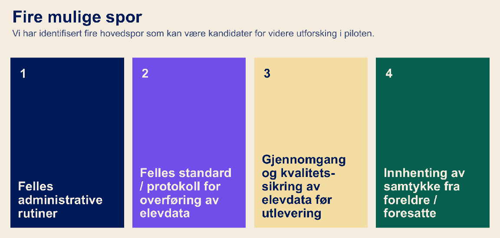
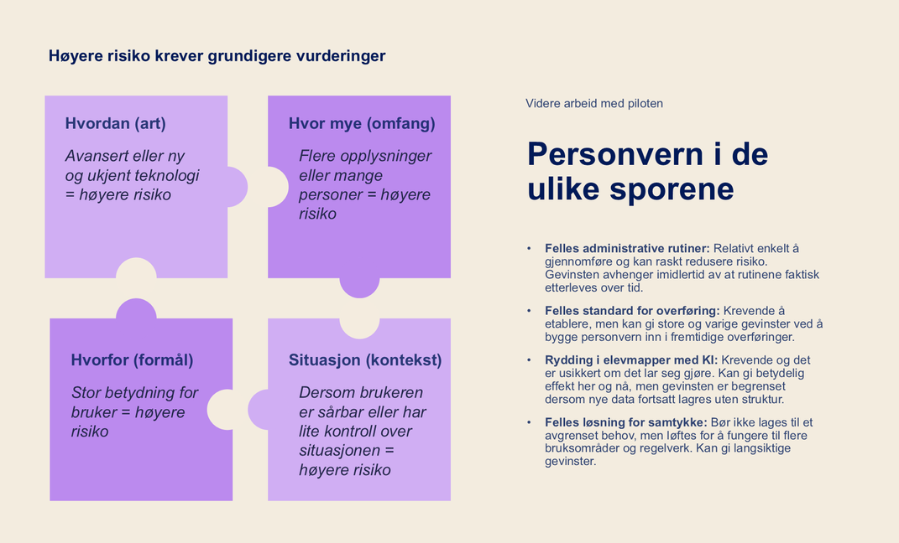

The workshops with Oslo and Nittedal produced four tracks that could be explored further. The tracks were shown at the demo on 4 September 2026. The pilot group then assessed them in a meeting and presented the assessment at the demo on 16 October.

## 1 Common administrative routines

There are no common routines for pupils who move, and the municipalities asked for them. This is basically not a digitalisation task and does not fall under SAMT-BU's mandate. The pilot has asked for a meeting with the Professional and Priorities Committee for School and Childhood in the joint governance structure, to propose it as a possible measure under the auspices of KS.

**Assessment:** proposed to KS, not taken further in the pilot.

## 2 Common standard for transferring pupil data

Grades and absence could have been sent as structured data between the school administration systems, instead of as PDF that must be typed in again. Several factors speak against going further with this in the pilot:

- It is unclear whether there is a national standard or metadata description for such data. The pilot has asked the project's information modelling team about OneRoster.
- The need seems to be limited. Few pupils move to each school during the school year, so the benefit of full automation hardly justifies the work of making a standard that the suppliers adopt.
- The need overlaps with the transfer of pupil data from lower secondary to upper secondary school in [Pilot 1](/en/pilotering/pilot-1/), and belongs more naturally there.

Schools that have not adopted Fiks SvarInn can get a simpler receiving process by doing so. KS Digital is developing a new version of the administrative solution for SvarInn.

**Assessment:** proposed to Pilot 1.

## 3 Review of documents in the pupil file before sending

The school the pupil moves from must assess which documents in the pupil file to send, and the documents are not labelled or categorised. A common framework for categorising the documents was considered too large a task for the pilot. However, examining whether an AI model can help school staff assess which documents are relevant was considered interesting, provided that the law allows it.

**Assessment:** to be explored further. See [Chosen solution now](/en/pilotering/pilot-3/loesningsvalg/valgt-loesning-naa/).

## 4 Common consent solution

Schools use many different solutions to obtain consent, so a common solution could have been a candidate. But consent to send pupil data when a pupil moves is only one of very many consents schools must obtain, for example for trips, photography and events. Much of the challenge is also about parents' language and digital skills. A solution for moves only risks becoming yet another system alongside the existing ones, and the municipalities said clearly that they do not want more solutions on top of the current ones.

**Assessment:** too large for the pilot. Should be seen in a wider context and can be lifted out as a separate track in SAMT-BU. The pilot will look more closely at the consent solutions that already exist at Digdir and KS Digital.

## Privacy in the tracks

How thorough the privacy assessments a track requires are depends on four factors: which technology is used (nature), how many people and how much information are involved (scope), what the information will be used for (purpose) and the situation of those concerned (context). New technology, a lot of information, great importance for the user and vulnerable users give higher risk.

| Track | Privacy |
|---|---|
| Common administrative routines | Relatively simple to carry out and can reduce risk quickly. The benefit depends on the routines actually being followed over time |
| Common standard for transfer | Demanding to establish, but can give large and lasting benefits by building privacy into future transfers |
| Tidying pupil files with AI | Demanding, and uncertain whether it is feasible. Can have a significant effect here and now, but the benefit is limited if new documents are still stored without structure |
| Common solution for consent | Should not be made for one limited need, but for several areas of use and sets of rules. Can give long-term benefits |

A short pilot cannot solve the most risky challenges on its own. The pilot must clarify what it can realistically solve now, and what must be built on in later pilots.
