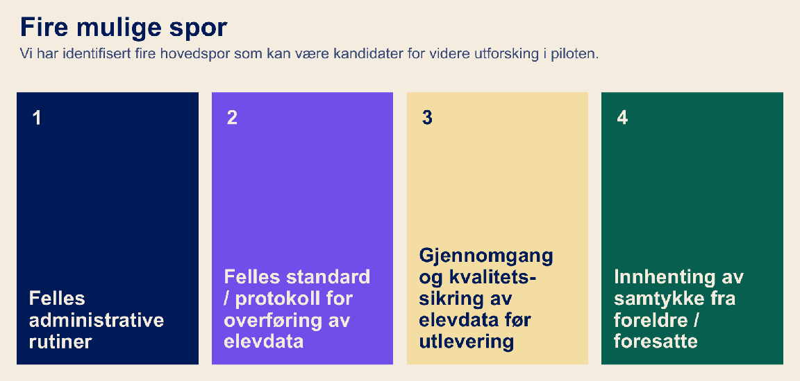
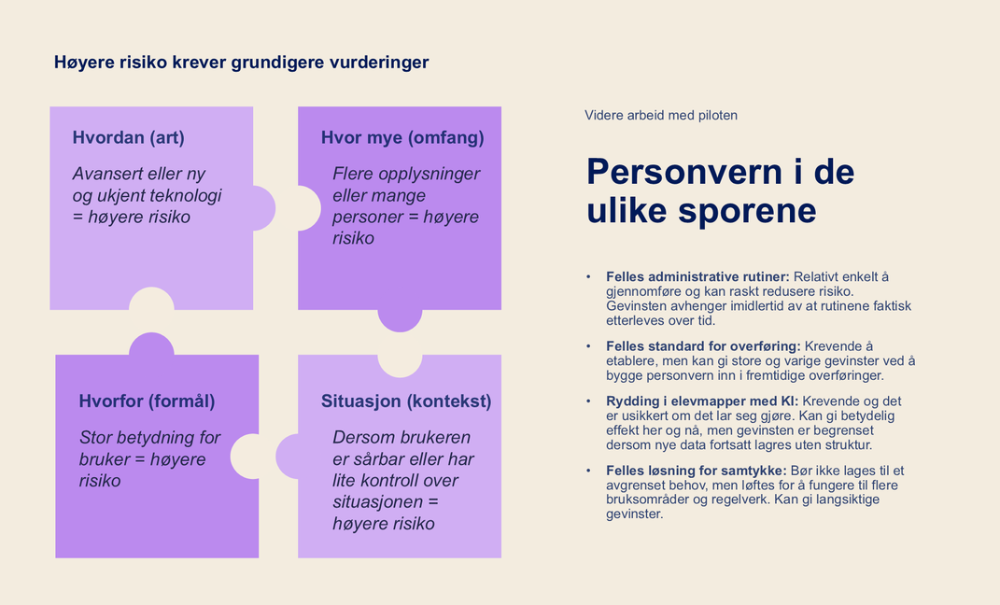

Workshopene med Oslo og Nittedal ga fire spor som kunne utforskes videre. Sporene ble vist på demoen 4. september 2026. Pilotgruppa vurderte dem deretter i et møte og la fram vurderingen på demoen 16. oktober.

## 1 Felles administrative rutiner

Det finnes ingen felles rutiner for flytting av elever, og kommunene etterlyste det. Dette er i utgangspunktet ikke en digitaliseringsoppgave og hører ikke inn under SAMT-BUs mandat. Piloten har bedt om møte med Fag- og prioriteringsutvalget for skole og oppvekst i samstyringsstrukturen for å spille det inn som et mulig tiltak i regi av KS.

**Vurdering:** spilles inn til KS, ikke videre i piloten.

## 2 Felles standard for overføring av elevdata

Karakterer og fravær kunne vært sendt som strukturerte data mellom de skoleadministrative systemene, i stedet for som PDF som må tastes inn på nytt. Flere forhold taler imot å gå videre med dette i piloten:

- Det er uklart om det finnes en nasjonal standard eller metadatabeskrivelse for slike data. Piloten har spurt prosjektets team for informasjonsmodeller om OneRoster.
- Behovet ser ut til å være begrenset. Det er få elever som flytter til hver skole i løpet av skoleåret, så gevinsten ved full automatisering forsvarer neppe arbeidet med å lage en standard som leverandørene tar i bruk.
- Behovet overlapper med overføringen av elevdata fra ungdomsskole til videregående i [Pilot 1](/pilotering/pilot-1/), og hører mer naturlig hjemme der.

Skoler som ikke har tatt i bruk Fiks SvarInn, kan få en enklere mottaksprosess ved å gjøre det. KS Digital utvikler en ny versjon av den administrative løsningen for SvarInn.

**Vurdering:** spilles inn til Pilot 1.

## 3 Gjennomgang av dokumenter i elevmappa før oversending

Skolen eleven flytter fra må vurdere hvilke dokumenter i elevmappa som skal sendes, og dokumentene er ikke merket eller kategorisert. Et felles rammeverk for å kategorisere dokumentene ble vurdert som et for stort arbeid for piloten. Å undersøke om en KI-modell kan hjelpe skolepersonalet med å vurdere hvilke dokumenter som er relevante, ble derimot vurdert som interessant, forutsatt at jussen tillater det.

**Vurdering:** utforskes videre. Se [Valgt løsning nå](/pilotering/pilot-3/loesningsvalg/valgt-loesning-naa/).

## 4 Felles samtykkeløsning

Skolene bruker mange ulike løsninger for å hente inn samtykke, så en felles løsning kunne vært en kandidat. Men samtykke til å sende elevdata ved flytting er bare ett av svært mange samtykker skolene må hente inn, for eksempel for utflukter, fotografering og arrangementer. Mye av utfordringen handler dessuten om foreldres språk og digitale kompetanse. En løsning bare for flytting risikerer å bli enda et system ved siden av de eksisterende, og kommunene sa tydelig at de ikke ønsker flere løsninger på toppen av dagens.

**Vurdering:** for stort for piloten. Bør ses i en større sammenheng og kan løftes ut som et eget spor i SAMT-BU. Piloten vil se nærmere på samtykkeløsningene som allerede finnes hos Digdir og KS Digital.

## Personvern i sporene

Hvor grundige personvernvurderinger et spor krever, avhenger av fire forhold: hvilken teknologi som brukes (art), hvor mange personer og opplysninger det gjelder (omfang), hva opplysningene skal brukes til (formål) og situasjonen til dem det gjelder (kontekst). Ny teknologi, mange opplysninger, stor betydning for brukeren og sårbare brukere gir høyere risiko.

| Spor | Personvern |
|---|---|
| Felles administrative rutiner | Relativt enkelt å gjennomføre og kan raskt redusere risiko. Gevinsten avhenger av at rutinene faktisk følges over tid |
| Felles standard for overføring | Krevende å etablere, men kan gi store og varige gevinster ved å bygge personvern inn i framtidige overføringer |
| Rydding i elevmapper med KI | Krevende, og usikkert om det lar seg gjøre. Kan gi betydelig effekt her og nå, men gevinsten er begrenset hvis nye dokumenter fortsatt lagres uten struktur |
| Felles løsning for samtykke | Bør ikke lages for ett avgrenset behov, men for flere bruksområder og regelverk. Kan gi langsiktige gevinster |

En kort pilot kan ikke løse de mest risikofylte utfordringene alene. Piloten må avklare hva den realistisk kan løse nå, og hva som må bygges videre på i senere piloter.
